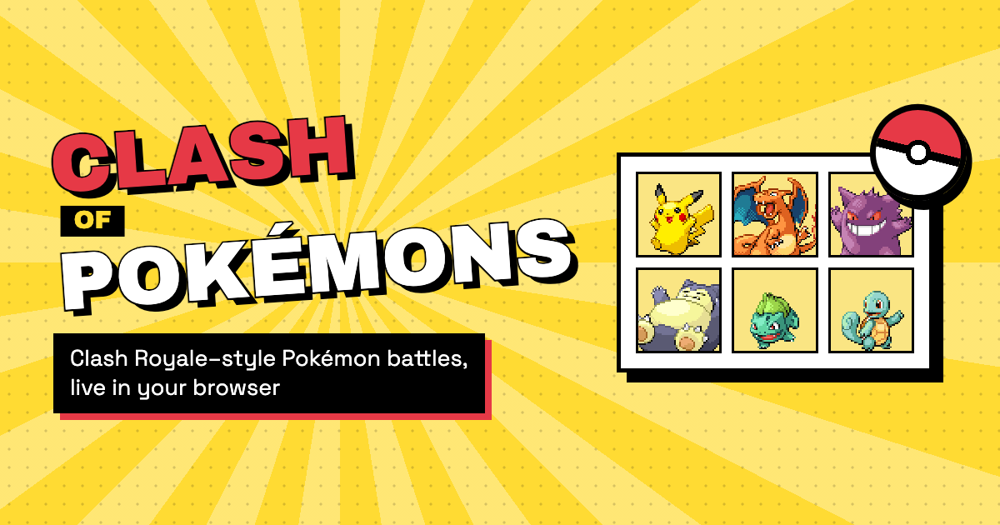
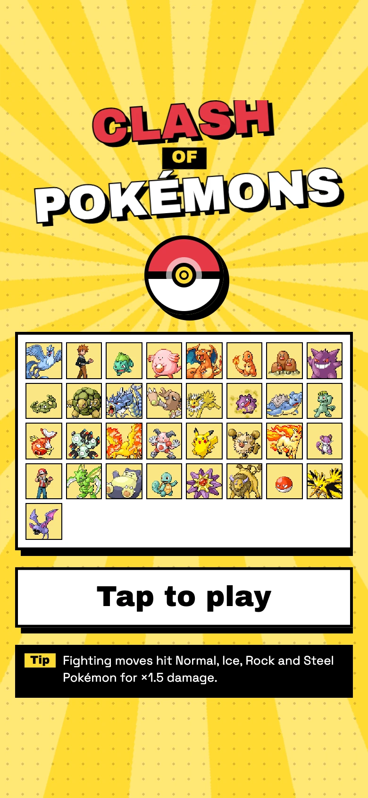
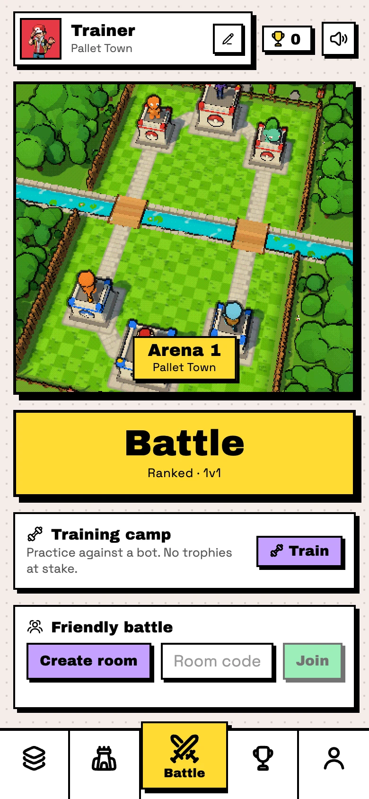
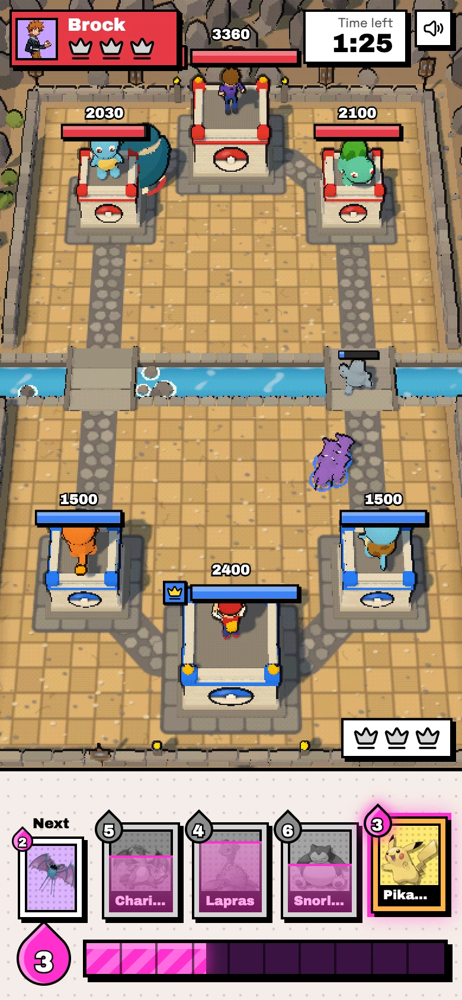
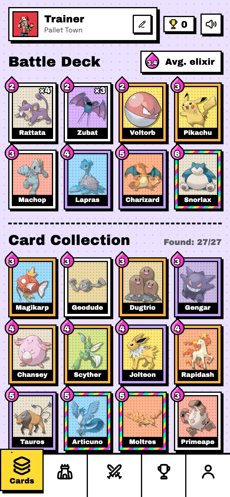
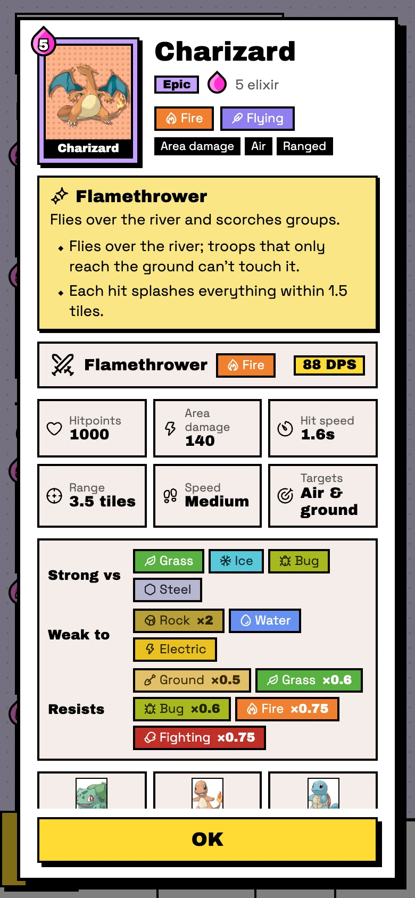

<p align="center">
  
</p>

# Clash of Pokémons

Clash Royale–style Pokémon battles, live in your browser. Your king tower is a trainer, your side towers are the starters you pick, and every card is a Pokémon.

<p align="center">
  
  
  
  
  
</p>

## Features

- **Real-time multiplayer**: a ranked ladder with trophies across ten Kanto arenas, friendly rooms by invite code, and a training bot.
- **Ghost battles**: when nobody else is searching, the queue matches you against a real trainer's deck, played by a bot that fights at their trophy level. Ghosts move trophies at half rate.
- **Kanto League** (on the Battle tab): 8 gyms, the Elite Four and Champion Blue, each with its own deck and twist. Earn up to 3 stars per stage.
- **Adventure**: the rest of single player.
  - **Daily Challenge**: the same seed, deck and rules for everyone, with a daily scoreboard.
  - **Weekly events**: a rotating mode (Triple Elixir, Mirror Match, Chaos, Sudden Death, Giants, Draft).
  - **Gauntlet**: back-to-back rounds against tougher bots, with tower damage carried between rounds and a season leaderboard.
  - **Puzzles**: six handcrafted setups that run fully in the browser.
- **Progression**: trainer XP and levels, daily quests, win streaks, and card unlocks by level or League badge. Profiles from before this update keep every card.
- **Replays**: every battle is recorded (a seed plus the plays) and can be rewatched from match history or shared by link.
- **Monthly seasons**: on the 1st, each trainer's final trophies and rank go on their profile.
- **27 Pokémon cards** with Clash Royale–style specialities (evolution, digging, invisibility, healing, chain lightning…) and the real type chart.
- **Starter towers**: pick two of Bulbasaur, Charmander and Squirtle to guard your side.
- **3D arena** with Blender-built, animated models, cel shading and ink outlines.
- **Chiptune sound**: synthesized 8-bit effects and Gen I cries.
- **No sign-up**: your trainer lives in the browser, and a restore code moves it between devices.

## Tech stack

| | |
|---|---|
| Client | TypeScript, Vite, three.js |
| Server | Node.js, Colyseus, Express |
| Data | Supabase (Postgres) |
| Game rules | Shared deterministic simulation (`packages/shared`), run by the server |
| Models | Blender, scripted in Python |
| Tests | Vitest |

## Getting started

Prerequisites: Node.js 22+, pnpm 10 and a Supabase project.

1. Install dependencies:

   ```bash
   pnpm install
   ```

2. Apply `supabase/migrations/*.sql` to your Supabase project (SQL editor or `supabase db push`).

3. Create `.env` in the repo root:

   ```
   SUPABASE_URL=https://<project>.supabase.co
   SUPABASE_SECRET_KEY=sb_secret_...
   ```

4. Start the client and server:

   ```bash
   pnpm dev
   ```

   Open http://localhost:5173. To battle yourself, use two browser profiles.

   No Supabase project? `pnpm --filter @cop/server local` runs the server on an in-memory Postgres (PGlite) with the real migrations; start the client with `pnpm --filter @cop/client dev` alongside. Nothing is kept when it stops.

| Variable | Used by | |
|---|---|---|
| `SUPABASE_URL` | server | Supabase project URL |
| `SUPABASE_SECRET_KEY` | server | Secret key; never sent to the client |
| `VITE_SERVER_URL` | client | Game server URL (defaults to the page's host on port 2567) |

## Scripts

| Command | |
|---|---|
| `pnpm dev` | Client and server with hot reload |
| `pnpm --filter @cop/server local` | Server only, on an in-memory database |
| `pnpm test` | All tests: rules, server rooms, client |
| `pnpm typecheck` | Type-check every package |
| `pnpm build` | Production build |
| `pnpm models` | Rebuild the 3D models (needs Blender) |
| `pnpm brand` | Re-render the icons and social card |
| `pnpm screenshots` | Re-capture these screenshots (needs `pnpm dev`) |

While `pnpm dev` runs, `/sandbox.html` stages scripted fights for tuning animations and `/gallery.html` shows every model.

## How to play

- Drag a card onto your half of the arena, or tap the card and then the arena.
- Elixir starts at 5, caps at 10 and refills one every 2.8 s, twice as fast in the final minute.
- A fallen side tower earns a crown and opens that lane for deploys; a fallen trainer wins outright.
- Matches last 3:00; a tie goes to 1:00 of sudden-death overtime.
- Type matchups matter: super effective ×1.5, not very effective ×0.75.
- League stages, Daily Challenges, events and the Gauntlet use shorter clocks and settle a tie by remaining tower health.

## Progression

| | |
|---|---|
| XP | Every battle pays XP: more for a win, plus a crown bonus, the first win of the day, a streak bonus and quests. Level *n* needs 80 + 40·*n* XP, up to level 30. |
| Cards | New trainers start with 15 of the 27 cards. The rest unlock in small batches at trainer levels 2 to 6 (legendaries last), and League first clears open some early. |
| Quests | Three a day (UTC), drawn from your profile ID and the date, so they're the same on every device. |
| Stars | 1 for beating a stage, 1 more for losing no tower, 1 more for three crowns. |
| Seasons | Monthly. Trophies above 1,000 are halved and top finishes are kept on the profile. |

Battles played against a server are scored on the server. Puzzles run on the client and only claim their one-time XP.

## Analytics

Besides page views, the client sends these custom [Vercel Analytics](https://vercel.com/docs/analytics) events from `apps/client/src/analytics.ts`: `battle_start`, `battle_end`, `queue_result`, `first_battle`, `league_clear`, `level_up`, `quest_complete`, `puzzle_solved` and `replay_watched`.

## Cards

| Card | Cost | Type | Speciality |
|---|---|---|---|
| Rattata ×4 | 2 | Normal | **Swarm**: Four quick biters that surround a target. |
| Voltorb | 2 | Electric | **Self-Destruct**: Rolls in and explodes on its first hit. |
| Zubat ×3 | 2 | Poison / Flying | **Swarm**: Three fliers that ground troops can’t reach. |
| Dugtrio | 3 | Ground | **Dig**: Deploy it anywhere: it tunnels in underground where nothing can hit it. |
| Gengar | 3 | Ghost / Poison | **Shadow**: Invisible and untargetable until it strikes; slashes everything nearby. |
| Geodude | 3 | Rock / Ground | **Explosion**: Tanky rock that goes for towers and explodes when it faints. |
| Machop | 3 | Fighting | Karate Chop |
| Magikarp | 3 | Water | **Evolve**: Splash does nothing… but survive 7 seconds and it evolves into Gyarados! |
| Mr. Mime | 3 | Psychic / Fairy | **Barrier**: Mimes up an invisible wall that soaks hits before its own health. |
| Pikachu | 3 | Electric | Thunderbolt |
| Primeape | 3 | Fighting | **Rage**: Below half health it flies into a rage: faster feet, faster fists. |
| Chansey | 4 | Normal | **Soft-Boiled**: Heals nearby allied troops every few seconds. |
| Jolteon | 4 | Electric | **Thunder Wave**: Every hit paralyzes its target for a moment. |
| Lapras | 4 | Water / Ice | Ice Beam |
| Magneton | 4 | Electric / Steel | **Magnet Turret**: Hovers in place like a Tesla, zapping air and ground. Lures tower-only troops; fades after 30 seconds. |
| Rapidash | 4 | Fire | **River Leap**: Gallops for towers and leaps straight over the river. |
| Scyther | 4 | Bug / Flying | **Fury Cutter**: Spins its scythes, hitting every ground enemy around it. |
| Starmie | 4 | Water / Psychic | **Swift**: Its stars fly straight on, piercing every enemy in the line. |
| Articuno | 5 | Ice / Flying | **Freeze**: Its icy splash slows enemies’ movement and attacks. |
| Charizard | 5 | Fire / Flying | **Flamethrower**: Flies over the river and scorches groups. |
| Golem | 5 | Rock / Ground | **Rollout**: Rolls a boulder that ploughs through every ground enemy in its path and knocks them back. |
| Koffing | 5 | Poison | **Poison Gas**: Floats over to towers and drops Sludge. When it faints it leaves a lingering poison cloud. |
| Moltres | 5 | Fire / Flying | **Fire Spin**: A flame stream that gets hotter the longer it burns one target. |
| Tauros | 5 | Normal | **Take Down**: After a short run it charges in, and its next hit does double damage. |
| Zapdos | 5 | Electric / Flying | **Chain Lightning**: Thunder arcs from its target to two more enemies, stunning each for a moment. |
| Hitmonlee | 6 | Fighting | **Jump Kick**: Lands with a slam when deployed, and leaps onto enemies a few tiles away for double damage. |
| Snorlax | 6 | Normal | **Body Slam**: A huge wall that only cares about towers. |

## Project structure

```
apps/client       Game client: menus, HUD, 3D battle, sound
apps/server       Colyseus rooms (battles, ranked queue, ghosts, Adventure modes) and the HTTP API
packages/shared   Game rules: simulation, cards, type chart, bot, replays, League, modes,
                  puzzles, progression, protocol
supabase          Database migrations
tools/blender     Scripted Blender models and animations
tools/brand       Icon, social card and screenshot rendering
```

## Credits

- Pokémon sprites and cries from [PokeAPI](https://github.com/PokeAPI) (loaded at runtime), trainer sprites from Pokémon Showdown.
- Icons by [Hugeicons](https://hugeicons.com) (MIT).
- Cel shading and ink outlines adapted from [sakura-crossing](https://github.com/Kenton-GMI/sakura-crossing) (MIT, © 2026 Kenton Wang).

A non-commercial fan project, not affiliated with or endorsed by Nintendo, Game Freak, The Pokémon Company or Supercell. Pokémon © Nintendo / Game Freak / The Pokémon Company; Clash Royale © Supercell.
